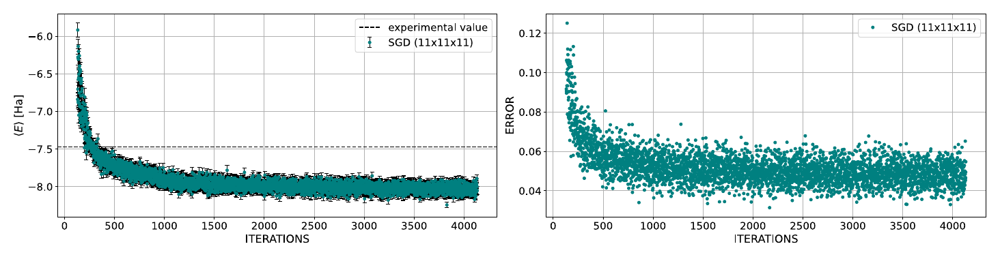
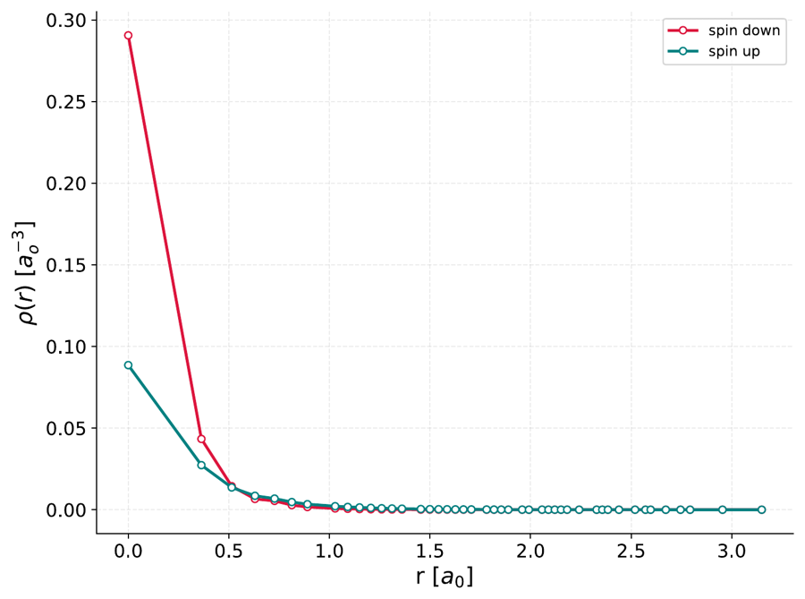
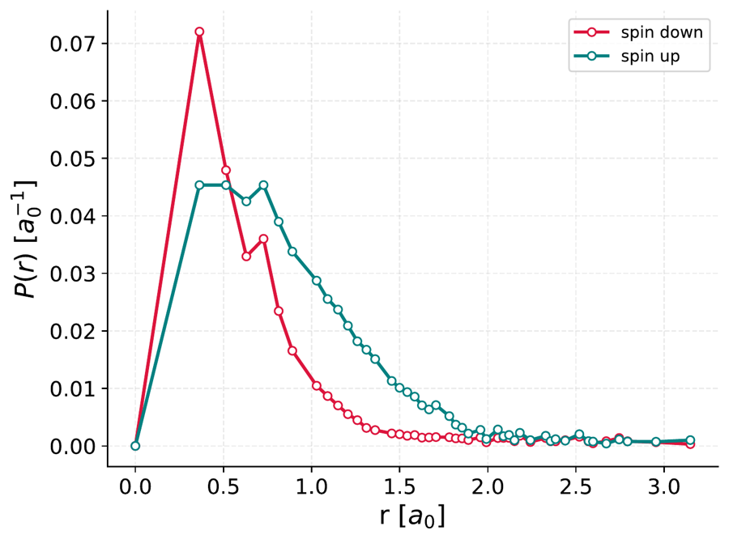
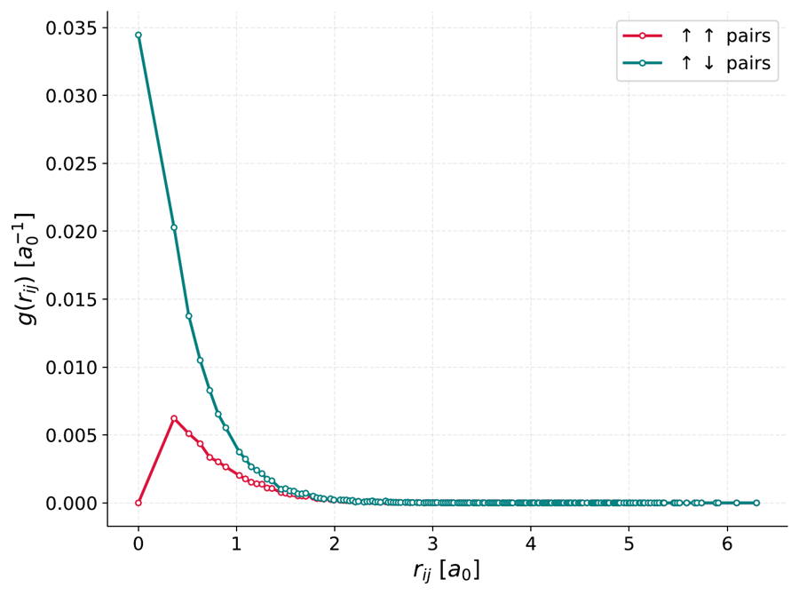

# NQS_RBM

This code uses a Restricted Boltzmann Machine (RBM) as a variational ansatz in the Variational Monte Carlo (VMC) scheme, to represent the wavefunction of fermionic systems in a three dimensional discretized box. The physical configuration is mapped on the visible layer in second quantization: every visible unit is the occupation number of a site of the lattice. All the parameters of the network are complex, configurations are sampled with Metropolis and the network is trained by minimizing the energy.

The method was first validated on few-electron atoms (helium and lithium) and then extended to nuclear physics with the deuteron, described by the Argonne V6 interaction. This was my BSc thesis work, the complete explanation from the theory to the implementation is in [Tesi_Borroni_finale.pdf](Tesi_Borroni_finale.pdf) and a short recap is in [RiassuntoTesiBorroni_finale.pdf](RiassuntoTesiBorroni_finale.pdf).

The code in this repo is the latest version, in which I'm still working on the deuteron after the thesis.

## Credits

The code started from the original NQS code by G. Carleo and M. Troyer, which I extended to fermions on a 3D lattice in second quantization, with atomic and nuclear Hamiltonians and a dedicated sampler for the deuteron. Their copyright notice is kept in `src/nqs_paper.hh` and the original paper is:

G. Carleo and M. Troyer, *Solving the quantum many-body problem with artificial neural networks*, Science 355, 602 (2017).

## Some results (lithium)

Energy and error during the training (first 4000 iterations) for the lithium atom with 10 hidden units. The experimental value is plotted just to give an idea of the magnitude of the energy, it is not the expected one: on a coarse lattice the discretized model gives a lower energy, so to compare with experiments a more detailed study of the lattice parameters is needed (see the thesis).



With the trained RBM I computed the radial density ρ(r), the radial distribution P(r) = 4πr²ρ(r) and the pair distribution function g(r), for the two spin up electrons and the spin down one:

| ρ(r) | P(r) | g(r) |
|:---:|:---:|:---:|
|  |  |  |

The spin down electron is much more localized near the nucleus, since it always occupies the 1s shell, while the spin up density is more spread because it is the average of the inner 1s electron and the outer 2s one. In g(r) the parallel pairs go to zero at r = 0 because of the Pauli principle, while antiparallel pairs are very likely to be found at short distance.

## Deuteron

For the deuteron the proton and the neutron live in a box with the center of mass fixed in the middle (default 9x9x9 sites), and each site has four channels: p↑, p↓, n↑, n↓. There are two versions of the potential:

- `ArgonneV6`: the AV6' potential evaluated directly on the lattice.
- `ArgonneV6Lattice`: AV6' smoothed with a gaussian regulator and recalibrated so that the exact ground state on the same lattice reproduces the deuteron binding energy (-2.2246 MeV).

The network can be trained with plain SGD or with a natural gradient (stochastic reconfiguration) where the linear system is solved with conjugate gradient, so that the Fisher matrix never has to be stored.

## Build

You need an MPI compiler and Eigen 3. Then simply run

```
make
```

If Eigen is not in `/usr/include/eigen3` give its path, for example on macOS with Homebrew `make EIGEN=/opt/homebrew/include/eigen3`.

## Usage

1) Set the parameters in `INPUTH2_CG.dat` (the file read by `optH2`), the list is below.
2) Run the training, for example on 4 processes:
```
mpirun -np 4 ./optH2        # optimizer from the input file
mpirun -np 4 ./optH2 cg     # force the CG natural gradient
```
The energy at every iteration goes in the `trainingfn` file, the weights and the other outputs in `TrainingTest/` and `SamplingTest/`.

Other programs:

- `Energy`: only inference, loads trained weights (`loadtype 2`) and measures the energy with a long sampling and block analysis, together with the proton-neutron distance. Run as `mpirun -np 4 ./Energy INPUTH2.dat`.
- `diagH2kron`: exact diagonalization of the deuteron on the same lattice, to have the reference value to compare with. Run as `./diagH2kron 9 4.0` (sites per side, box length).
- `Wfplotter`: loads saved weights and computes the spatial plots and some sections of the wavefunction.

## Input parameters

```
nv          number of visible units = lattice sites
nh          number of hidden units
sigma       std deviation of the gaussian initializer for the weights
loadtype    0: random weights, 1: visible from file, random hidden,
            2: all weights loaded from file, 3: all weights from file + new random hidden
restartfn   file containing the weights to load
model       ArgonneV6 / ArgonneV6Lattice
M           number of particles
spin_up     spin up particles
spin_down   spin down particles
seed        random seed (-1 for random)
printstates 1 to print the sampled configurations on file
filestates  file for the sampled configurations
nsweeps     number of Metropolis sweeps per iteration (divided between the processes)
niter       number of training iterations
get_pars    save the weights every get_pars iterations
Nprotons    Z (number of protons, for atoms)
traplength  physical length of the box (a_0 for atoms, fm for nuclei)
isospin     0 for atoms, 1 for nuclei
iso_up      number of protons
iso_down    number of neutrons
eta         starting learning rate
eta1        learning rate decay
label       label used in the names of the output files
trainingfn  output file with energy and error at every iteration

optional:
optimizer       sgd or cg
cg_lambda       relative regularization of the Fisher matrix
cg_rtol         tolerance of the conjugate gradient
cg_maxiter      max conjugate gradient iterations
cg_maxstep      max size of a parameter update
smear_b_factor  width of the gaussian regulator in units of the lattice spacing (ArgonneV6Lattice)
```

## Notes

- The atomic Hamiltonians used for the thesis results (`src/Coulomb3d.cc`, `src/Trap3d.cc`) are still in the repo, but in this version of `optH2.cc` only the deuteron models are enabled.
- The deuteron energy has to be compared with the exact ground state of the same lattice (`diagH2kron`), not directly with the experimental binding energy.
